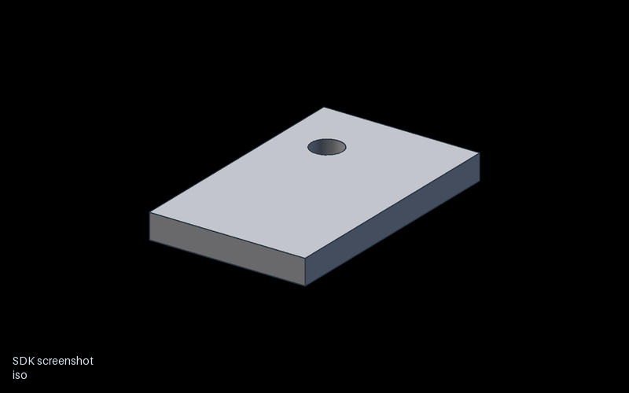
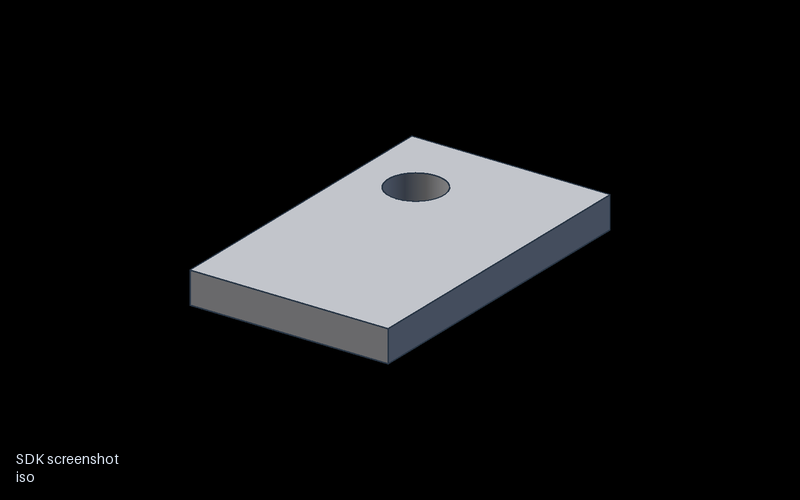
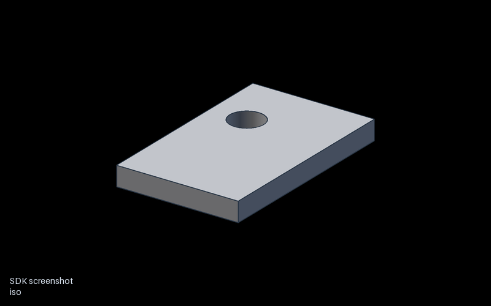

# 偏置通孔板的 SCA 验证记录

参数化 notebook 在新进程中的改参、导出和回读证据另见 [notebook 交付验证](notebook/README.md)。

## STEP 截面探测验证

[verify_step_sections.py](verify_step_sections.py) 在临时目录导出一个矩形两臂的 L 形支架，再从 STEP 路径回读 `x=20` 和 `z=20` 截面。探测线使用当前宽度的中点。它验证回读路径和该直边夹具的探测线计算，应用层选择器、T3 圆角版及 T4 缺口边界匹配另行联调。

```powershell
.venv/Scripts/python.exe -B verify_step_sections.py
```

宽度 25 mm 时探测线 `Y=12.5 mm`，宽度 30 mm 时 `Y=15 mm`，两次回读的水平与竖直壁厚均为 4 mm。

2026-11-25，在 Windows 11 x64（build 26200）、CPython 3.12.13、uv 0.10.12 的独立环境中，使用 PyPI 的 SimpleCADAPI 2.3.0.post1 Windows wheel。完整依赖见 [requirements.txt](requirements.txt)。wheel 名为 `simplecadapi-2.3.0.post1-cp312-cp312-win_amd64.whl`，PyPI 登记的 SHA-256 为 `10fb6bb4a688f14db528f5055f82119f094b99343b0cf8909a41b07f61f27ae5`。源码参考发布标签 v2.3.0.post1，提交 `95cdd5fe5d2ea0b2524ad5dbf16d115c48313486`。[PyPI 发布记录](https://pypi.org/project/simplecadapi/2.3.0.post1/) · [版本源码](https://github.com/PhySpace/SimpleCADAPI/tree/95cdd5fe5d2ea0b2524ad5dbf16d115c48313486)

## 验收约定与建模方法

预先定义一块 80 × 50 × 8 mm 矩形板。底面左下角为 (0, 0, 0)，在 XY 面创建矩形，沿 +Z 拉伸，切除竖直圆柱。初始通孔直径 10 mm，轴线距左边 20 mm、距下边 15 mm。修改只把孔径增至 14 mm。每个尺寸的绝对容差均为 0.01 mm，恰好处在边界时通过。对照组在修改后的同一验收条件下，将建模输入的 X 距离改为 25 mm。[预设条件与输入](cases.json) · [建模与校验代码](plate.py)

每次导出 STEP 后，用 `inspect_step_rbrepinspection` 回读。检查单个有效实体，读取包围盒计算三轴尺寸，通过唯一圆柱面的半径和轴线位置测量孔径与两项边距。另检查轴线与 Z 平行、孔壁上的两条圆边分别在板顶面和底面。检查器在回读数据上计算带符号误差 `实测 − 目标`，逐项返回失败的字段。SDK 提供边、面、体等几何事实，选定目标、识别孔壁和比较容差由实验代码完成。[SCA 检查实现](https://github.com/PhySpace/SimpleCADAPI/blob/95cdd5fe5d2ea0b2524ad5dbf16d115c48313486/src/simplecadapi/inspect/brep/inspect.py) · [原始记录](results/before.brep.json)

## 本地实测 · 已核实

| 工况 | 实测板尺寸 mm | 实测孔径 mm | 实测孔边距 X / Y mm | 实测体积 mm³ | 验收、偏差 | 用时 s |
|---|---|---:|---|---:|---|---:|
| 初始 | 80 × 50 × 8 | 10 | 20 / 15 | 31371.6815 | 通过，六项尺寸偏差均为 0 | 0.1815 |
| 改孔径 | 80 × 50 × 8 | 14 | 20 / 15 | 30768.4957 | 通过，六项尺寸偏差均为 0 | 0.0698 |
| 偏位反例 | 80 × 50 × 8 | 14 | 25 / 15 | 30768.4957 | 拒绝，只有 X 边距偏差 +5 mm | 0.0683 |

三组均回读为一个有效实体，六个平面、一个圆柱面、两条圆边，贯穿检查通过。后两组的体积在表内精度下相同，区别在孔相对板边的位置，可作为“生成成功但需求不符”的演示例。用时为单次建模、导出、回读检查、保存 BRep 和渲染的实耗，未计解释器启动或安装；本次没有模型调用或自动修复，修复次数均为 0。[结果及逐字段误差](results/run.json) · [偏位反例几何](results/off_target.brep.json)

| 初始 Ø10 | 修改后 Ø14 | 相同 Ø14、孔位偏移 |
|---|---|---|
|  |  |  |
| [下载 STEP](results/before.step) | [下载 STEP](results/after.step) | [下载 STEP](results/off_target.step) |

三图由 SDK 对建成的实体以相同等轴视角渲染。查看时能比较孔口大小和位置，精确距离来自 STEP 回读。导出使用 `simplecadapi.kernel.ocp_export.export_step_shapes`；本次三份文件的头部标记为 Open CASCADE 7.9、AUTOMOTIVE_DESIGN（AP214）。[导出函数](https://github.com/PhySpace/SimpleCADAPI/blob/95cdd5fe5d2ea0b2524ad5dbf16d115c48313486/src/simplecadapi/kernel/ocp_export.py)

## 复现

在本目录打开 PowerShell，使用 uv 执行以下命令。默认输出为本目录的 `results`。命令指定另一目录，方便并排核对。

```powershell
uv venv --python 3.12.13 .venv
uv pip install --index-url https://pypi.org/simple --python .venv/Scripts/python.exe -r requirements.txt
.venv/Scripts/python.exe plate.py --out results-reproduced
```

运行后会打印 `before True []`、`after True []` 和 `off_target False ['hole_x']` 及各自的实测数据。三个判定均符合各自预期时脚本返回 0。可修改 [cases.json](cases.json) 中的尺寸并重建。第二次在独立进程和输出目录运行时，三份 BRep JSON 逐份一致，三张 PNG 字节一致。另用新建虚拟环境按 requirements.txt 安装全部 49 个固定版本后，三个验收判定也全部复现。STEP 带写出时间，运行时间也会波动。

## 能力边界

本地实测覆盖同一单孔板的参数化重建、查看、导出及尺寸验收。参数变更来自固定配置。自然语言澄清、会话状态更新、工具异常反馈、Agent 自动修复与重试上限，以及对生成代码的隔离和超时仍待端到端验证。单圆柱面选择依赖本例只有一个圆柱面的前提，多孔或带圆角零件需要额外的孔识别和测试。本例的三个工况只覆盖一种结构。
